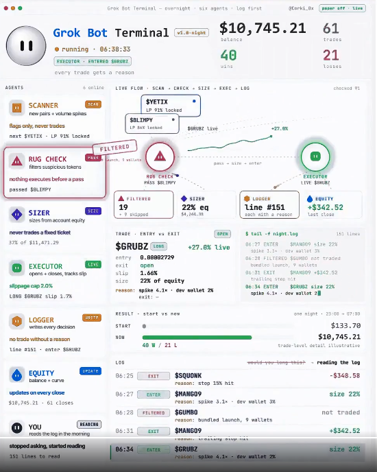

# Design system, fidélité et tokens

> **0-hl — Bible V2.1 | 17 novembre 2026 | Statut : spécification de référence (source unique de vérité)**
> **Traçabilité :** `[OBS]` vu dans les captures ; `[INF]` inféré ; `[SPEC]` à construire ; `[OPEN]` à arbitrer.

## Direction artistique

Reproduction du style clair, dense, monospace et technique de la capture 3. L'écran canonique est un petit canvas 550×688 ; **depuis ADR-016**, il n'est plus la vue par défaut de UI-01 mais une option « Reference canvas » servant à la mesure de fidélité, la vue par défaut étant une disposition pleine largeur dans le même langage visuel. Le Back-Office élargit la grille à 1440×900 et réutilise les mêmes couleurs fonctionnelles, microtypographie et bordures.

## Tokens CSS de référence à recalibrer par comparaison visuelle

```css
:root {
 --canvas:#fbfafb; --surface:#fff; --surface-soft:#f6f5f7;
 --ink:#1b1c21; --muted:#85838f; --line:#e8e6eb;
 --amber:#b47a28; --pink:#b23c63; --violet:#5642bf;
 --green:#20995a; --blue:#0465c9;
 --radius-small:4px; --radius-panel:6px;
 --shadow:0 2px 7px rgba(25,26,33,.09);
 --font-mono:'IBM Plex Mono','DM Mono',monospace;
}
```

## Mise en page canonique

En-tête système (pastilles, nom, mode) → barre métrique (pause, titre, uptime, balance, W/L) → agents gauche (6 + YOU) → diagramme central (scan, check, size, execute) → TRADE et console → equity → log récent → ticker inférieur noir. Toutes les cartes, séparateurs et arêtes du flux restent proches des positions originales. La vue large doit conserver l'option « Reference Canvas », sans redessiner la composition.

## Adaptations de contenu 0-hl (ADR-001, ADR-004)

La géométrie, les couleurs et la hiérarchie de la capture 3 sont conservées ; seuls les **textes** changent : titre `0-hl` à la place de « Grok Bot Terminal » (même graisse et position, le badge de version affiche la version 0-hl), identifiant utilisateur à la place de `@Corki_0x`, badge `paper · live` reflétant l'environnement réel du bot (`PAPER` au M1). Les cartes de candidats affichent des paires Kraken (`BTC/USD`, `$SOL`…) et les motifs du RUG CHECK variante CEX (spread, profondeur, statut) au lieu de LP lock / dev wallet. Les valeurs proviennent exclusivement du snapshot API et des événements ; aucune valeur de la capture n'est codée en dur hors mode démo.

## Typographie et densité

Utiliser des nombres tabulaires, alignement de décimales, badges microcaps, libellés courts ; palette contenue. Les nombres de money utilisent format de devise configuré, sans changement brutal de largeur au tick. Les valeurs partielles/indisponibles sont affichées `—`, jamais `0` ; `UNKNOWN` et `STALE` sont des états explicites.

## Accessibilité

Contraste de texte, états non dépendants de la couleur, focus visible, navigation clavier, support `prefers-reduced-motion`, alternative textuelle du pipeline pour lecteurs d'écran, cible interactive ≥ 32×32 sur desktop et ≥44×44 sur mobile en mode opérateur. Aucun contrôle critique caché uniquement par survol.

## Mesures de fidélité

Créer captures Playwright à 550×688, faire overlay 50 % avec la capture 3, mesurer DOM bounding boxes et score de différence perceptuelle. Les divergences de police doivent être documentées ; appliquer un seuil par région, pas seulement un score global. Les PNG d'admin du présent dossier sont des **directions de design** à valider, pas une référence pixel-perfect comparable à la capture principale.


