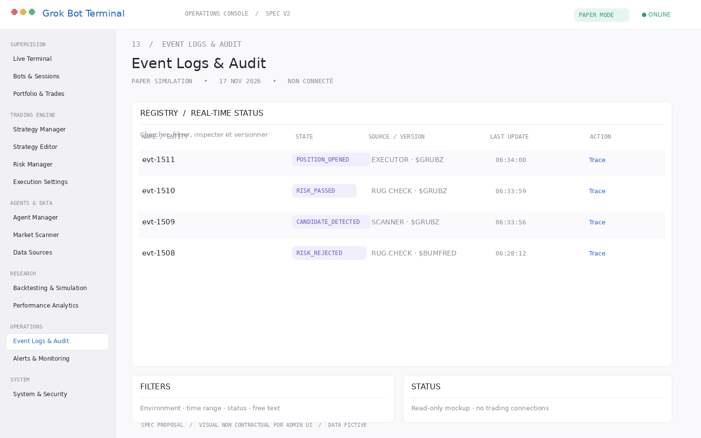

# UI-13 — Event Logs & Audit

> **0-hl — Bible V2.1 | 17 novembre 2026 | Statut : spécification de référence (source unique de vérité)**
> **Traçabilité :** `[OBS]` vu dans les captures ; `[INF]` inféré ; `[SPEC]` à construire ; `[OPEN]` à arbitrer.

## Fiche écran normative

**Objectif.** Recherche et traçabilité.

**Éléments de page.** Table événements timestamp, type, trace, acteur, status, correlation.

**Actions.** Recherche, filtres, timeline corrélée, diff config, export.

**Invariant critique.** Append-only et identité de l’auteur pour changements critiques..

## Layout précis

- Barre système persistante : identité, environnement, dernier événement serveur, statut de connexion, bouton retour terminal.
- Navigation latérale : regroupement des 15 écrans, état actif contrasté, réduction/expansion et clavier.
- Bandeau contextuel : nom de l'écran, instance courante, filtres persistés dans URL, dernière synchronisation.
- Surface métier : panneau gauche (liste / navigation), centre (données), droite (détails) selon la maquette.
- Pied : nombre de résultats / pagination, information de provenance et date des données.
- À 1440×900 : pas de scroll horizontal sur le cadre global ; une table dense peut scroller dans sa zone.

## Comportements standards

- `LOADING` : skeleton des zones de données ; aucune valeur financière artificielle.
- `EMPTY` : message métier, action autorisée pour démarrer, sans graphique trompeur.
- `STALE` : bandeau orange + âge des données et source défaillante ; calcul de trade désactivé.
- `ERROR` : code stable, correlation ID et bouton réessayer si commande idempotente.
- `FORBIDDEN` : explication de permission requise sans exposer des secrets.
- `CONFLICT` : comparer version locale/distante avant soumission.

## Contrat API et flux

Les lectures sont `GET /api/v1/...` filtrées par `bot_id`/`session_id` lorsque pertinent. Les mutations sont `POST`, `PATCH` ou commandes dédiées avec `Idempotency-Key` et `If-Match` pour configurations versionnées. Le WebSocket émet des deltas, suivis d'un snapshot de rattrapage en cas de gap de séquence. Toute mutation critique génère `AUDIT_EVENT`.

## Tests de recette

- **UI-UI-13-01** Étant donné des données nominales, lorsque l'utilisateur ouvre la vue, alors les sections et valeurs correspondent au snapshot API.
- **UI-UI-13-02** Étant donné un échec serveur, lorsqu'une action est tentée, alors aucune réussite fictive n'est affichée et le correlation ID est accessible.
- **UI-UI-13-03** Étant donné un utilisateur sans permission, lorsque l'action sensible est demandée, alors backend retourne `403` et UI affiche la restriction.
- **UI-UI-13-04** Étant donné un ordre d'événements retardé, alors l'écran conserve une vue cohérente grâce à `sequence` et snapshot.
- **UI-UI-13-05** À 1440×900 et clavier seul, toutes les actions autorisées restent accessibles ; les indicateurs de statut restent compréhensibles sans couleur.

## Corrélation

Un clic sur `correlation_id` expose un DAG d’événements depuis le candidat jusqu’au settlement ; les messages IA, s’il y en a, sont des artefacts explicatifs sans autorité d’exécution.
