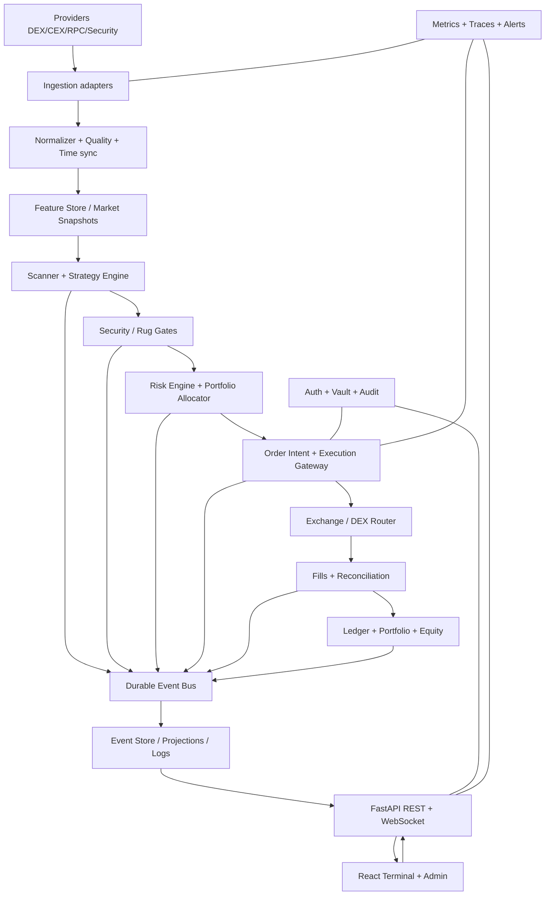

# GROK BOT TERMINAL
## Bible produit, fonctionnelle, UX/UI, architecture, trading et exploitation

**Version :** 1.0 — spécification de référence pour le développement  
**Date :** 17 novembre 2026  
**Statut :** proposition de conception détaillée à valider ; non-description certifiée du logiciel original  
**Langue :** français ; libellés de l'interface principale en anglais conformément aux captures  
**Public :** Product Owner, designer, développeurs frontend/backend, quant, DevOps/SRE, QA, sécurité  
**Objet :** développer un terminal de trading événementiel multi-agents avec reproduction graphique fidèle de la vue principale et back-office administrable.

> **Avertissement :** ce document définit un système de recherche, simulation, paper trading et — sous conditions strictes — exécution réelle. Aucun rendement n'est promis. Les actifs récemment créés sont exposés à des risques sévères de fraude, défaut de liquidité, latence et pertes. La priorité du projet est la fiabilité des données, le contrôle déterministe du risque, la traçabilité et la possibilité d'interrompre proprement les nouvelles opérations.

---

# PARTIE I — CADRAGE, PREUVES ET VISION

## 1. Objet et règle de vérité

La présente bible réunit **quatre périmètres** : (a) reproduction fidèle du terminal visible dans trois captures, (b) spécification des écrans administratifs nécessaires, (c) backend événementiel et connexions, (d) théorie, calculs, validation et exploitation des stratégies. Elle doit pouvoir être transmise directement à une équipe ou à des agents de développement comme référence contractuelle.

Les assertions sont classées :

- **[OBS] Observé** dans les captures ou le prototype HTML inspecté.
- **[INF] Inféré** à partir de ces observations, non démontré.
- **[SPEC] Exigence proposée** pour le produit à construire.
- **[OPEN] Décision ou information à confirmer** avant production.

Tout écart entre [OBS] et [SPEC] doit être documenté. En cas de conflit graphique, **la troisième capture est la référence canonique de l'écran principal**, les deux premières documentant les états alternatifs. En cas de conflit métier, la sécurité et la comptabilité priment sur la fidélité esthétique.

## 2. Corpus et relevés vérifiables

Fichiers de référence locaux : `image(20261116-150453).png` (553×683 px), `image(20261116-151126).png` (562×684 px), `image(20261116-151457).png` (550×688 px). Prototype initial : `grok-terminal-replica/index.html`, rendu de référence `grok-terminal-replica/preview.png` (550×688 px). Les images sont des références visuelles, non un accès à la logique source du logiciel original.

| Caractéristique | Capture 1 | Capture 2 | Capture 3 |
|---|---:|---:|---:|
| Temps écoulé | 02:45:35 | 04:23:06 | 06:38:33 |
| Balance affichée | $1,344.98 | $3,362.91 | $10,745.21 |
| Trades clôturés | 30 | 43 | 61 |
| Wins | 22 | 29 | 40 |
| Losses | 8 | 14 | 21 |
| Filtered | 13 | 16 | 19 |
| Trade actif | $RIZZO | $CHIRPO | $GRUBZ |
| Position affichée | 44% equity | 43% equity | 22% equity |
| Variation affichée | -7.4% | -3.6% | +27.8% |

[OBS] Présence des agents `SCANNER`, `RUG CHECK`, `SIZER`, `EXECUTOR`, `LOGGER`, `EQUITY`, plus `YOU` (observateur). Bandeau `Grok Bot Terminal`, mention `v1.8-night` ou similaire, état `running`, badge `paper off · live`, slogan `every trade gets a reason`, graphe de flux `SCAN → CHECK → SIZE → EXEC → LOG`, journal `ENTER / EXIT / FILTERED / SKIP`, panneau trade, panneau résultat et bandeau noir en pied `stopped asking, started reading`.

[OBS] Exemples de raisons affichées : `volume 5.8x in 5m`, `LP locked 90d`, `LP 98% locked`, `breakout over 1h high`, `dev wallet 2%`, `bundled launch, 9 wallets`, `spread 4.1%, waiting`, `stop 10% hit`, `stop 15% hit`, `take-profit 2R`, `take-profit 3R`.

[OBS] Les valeurs d'allocation en pourcentage ne se réconcilient pas toujours avec le capital affiché. Elles **ne doivent jamais devenir des tests de vérité comptable**. La balance ne suffit pas à démontrer un rendement, des dépôts/retraits ou une exécution réelle. [INF] La stratégie semble orientée momentum de nouvelles paires DEX, éventuellement memecoins ; réseau, fournisseur, LLM et présence de vrais ordres restent indéterminés.

## 3. Vision produit et principes non négociables

Créer un **poste de pilotage explicable**, comprenant : découverte en temps réel, validation multi-étapes, construction de la position, exécution encadrée, restitution des données et administration. La philosophie est « log first » : à toute décision correspond un événement horodaté et une justification reproduisible.

Principes :
1. **Une seule source de vérité** en backend pour les positions, ordres, cash, equity et configurations.
2. **Agents ≠ stratégies** : les agents sont des services réutilisables ; les stratégies sont des ensembles versionnés de règles.
3. **Sécurité indépendante de l'IA** : aucune sortie de LLM ne peut passer outre une limite bloquante.
4. **Configuration immuable par version** pour chaque session ; tout changement est audité et appliqué selon une politique explicite.
5. **Event sourcing pragmatique** : événements métiers append-only + vues matérialisées dérivées ; ne pas confondre journal d'interface et ledger financier.
6. **Défaillance restrictive** : en absence de donnée fiable, refuser la nouvelle entrée ; continuer à surveiller les positions existantes via une voie de secours.
7. **Paper d'abord** : simulation et rapprochement obligatoires avant l'activation live.
8. **Reproduction visuelle fidèle** de l'écran canonique sans sacrifier l'accessibilité ni la séparation fonctionnelle.
9. **Aucune promesse de profit** ; objectifs de performance exprimés en fiabilité technique et qualité de risque, non en rendement.

## 4. Périmètres et priorités

**MVP P0** : terminal fidèle, collecte minimale, scanner, contrôle sécurité, stratégie déclarative, sizing, simulation, journal, états financiers paper, admin stratégies/risques/bots/connexions, auth, supervision et tests.  
**P1** : exécution live **après gates**, multi-bots, reporting détaillé, alertes, réconciliation et replay, traces complètes, backtesting événementiel.  
**P2** : moteur de recherche de stratégies, comparaison multicritère, plusieurs réseaux, intelligence assistée, expérimentation contrôlée, optimization walk-forward.  
**Hors périmètre initial** : garde de fonds pour des tiers, courtage, levier/futures, copy trading ouvert au public, manipulation de marché, service de signaux vendus, stratégies à promesse de rendement.

## 5. Personae et permissions

- **Observer** : lire le terminal, les performances agrégées et les journaux non sensibles.
- **Analyst** : créer brouillons de stratégie, lancer backtests, annoter les sessions, aucun ordre réel.
- **Operator** : démarrer/mettre en pause une instance approuvée, acquitter alertes et gérer les incidents selon autorisation.
- **Risk Officer** : approuver limites de risque, verrouillages, passage live et changements critiques.
- **Administrator** : gérer comptes, connecteurs, déploiements, identités et secrets sans voir les secrets en clair.
- **Service Account** : permissions minimales pour ingestion, exécution, reporting ; aucune identité partagée.

Politique RBAC +, pour les opérations sensibles, conditions ABAC : environnement, instance, horaire, niveau d'approbation, MFA, version de configuration.

---

# PARTIE II — DESIGN SYSTEM ET REPRODUCTION FIDÈLE

## 6. Règle de fidélité visuelle

Écran canonique ≈ **550×688 px** dans la capture 3. Reproduire la densité d'information, ordre de lecture, repères, proportions, textes, cartes, ombres, contrastes, courbes, pictogrammes et bandeau inférieur. La référence principale utilise un rendu « mini-terminal desktop » sur un canevas blanc cassé, pas un dashboard générique. Les écrans admin dérivent de ce langage mais peuvent utiliser une grille plus large pour être utilisables.

**Méthode pixel-perfect** : verrouiller un viewport de référence 550×688 en mode comparaison ; superposer image source/rendu à 50% d'opacité ; mesurer décalage des repères majeurs, bounding boxes, couleurs et épaisseurs ; ne pas juger uniquement sur capture subjective. Les erreurs de 1-2 px sont critiques pour les petites typographies. La première implémentation HTML est un prototype, **pas une conformité vérifiée**.

### 6.1 Tokens visuels de départ (à recalibrer sur les captures)

```css
:root {
  --ui-canvas:#fbfafb; --ui-panel:#ffffff; --ui-ink:#191a21;
  --ui-secondary:#777887; --ui-muted:#a0a0a8;
  --ui-line:#e9e8eb; --ui-soft:#f3f2f5;
  --agent-scanner:#b47a28; --agent-rug:#b23c63;
  --agent-sizer:#5642bf; --agent-executor:#20995a;
  --agent-logger:#b47a28; --agent-equity:#0465c9;
  --positive:#20995a; --negative:#b23c63; --info:#0465c9;
  --radius-chip:3px; --radius-card:5px;
  --shadow-card:0 2px 7px rgba(25,26,33,.09);
  --shadow-active:0 0 0 1px currentColor,0 3px 11px rgba(0,0,0,.10);
}
```

Ce tableau est une **base mesurée/estimée**, pas une extraction colorimétrique certifiée. Tolérer une variation de tonalité mineure lors de la première intégration ; valider ensuite par test d'image. Prévoir les variables `--z-flow`, `--z-card`, `--z-popover`, `--z-modal`, `--z-toast` et éviter les z-index arbitraires.

### 6.2 Typographie

Style code/monospace dominant : chiffres tabulaires, titres contrastés et denses, micro-texte pour badges et justificatifs. Utiliser une police locale/open-source disponible sous licence compatible ou une cascade `"DM Mono", "IBM Plex Mono", "Courier New", monospace`; ne jamais dépendre exclusivement d'une police distante en production. Règles : capital du header 20–23 px à la taille de référence ; titre 15–18 px ; grands chiffres secondaires 15–20 px ; libellés d'agents 8–10 px ; texte fonctionnel 7–9 px ; microstatuts 5–7 px. Valeurs indicatives à ajuster par capture.

Ne pas forcer des tailles illisibles aux résolutions ordinaires. La **vue réplique** respecte la capture à 550×688 ; la vue large augmente la taille minimum pour l'accessibilité. Utiliser `font-variant-numeric: tabular-nums` et une convention déterministe d'arrondi monétaire.

### 6.3 Composition exacte de l'écran principal

1. **Top chrome** : trois pastilles rouge/jaune/vert en haut à gauche ; petite ligne de titre centrée ; pseudo-identité @... ; badge `paper off · live` en haut à droite.
2. **Header** : bouton circulaire Pause très visible (coin gauche), titre bleu `Grok Bot Terminal`, petit badge de version, statut `running`, durée, mini-bandeau du dernier événement ; capital et trades en gros à droite, wins vert, losses rose.
3. **Sous-header** : fine ligne d'information `AGENTS · 6 online · LIVE FLOW · SCAN + CHECK + SIZE + EXEC + LOG · checked N`.
4. **Colonne gauche ~29%** : empilement des six agents avec icône circulaire/carrée, badge du rôle, nom en couleur, phrase de description, événement récent, prochain token, statut ; septième entité `YOU` en bas.
5. **Zone centrale haute** : cartes de tokens en haut, liens pointillés, courbe sparkline, nœuds RUG CHECK et EXECUTOR cerclés, noms de tokens, badges d'état `FILTERED`, `PASS`, `LIVE`.
6. **Zone centrale médiane** : compteurs FILTERED, SIZER, LOGGER, EQUITY sous les nœuds ; panneau TRADE à gauche et mini flux `tail -f night.log` à droite.
7. **Zone résultats** : START/NOW avec piste horizontale, barre wins/losses, solde final, évolution.
8. **Zone LOG** : en-tête et quelques événements récents en lignes compactes avec heure, action, token, motif et résultat.
9. **Bottom ticker** : bande dégradée sombre, texte `stopped asking, started reading`, compteur de lignes, événement le plus récent mis en évidence.

**Interdit** pour la version réplique : remplacer le diagramme par un graphe React Flow standard, grosses cartes SaaS, gradient saturé, tableaux financiers génériques ou graphes chandeliers plein écran. Ces éléments peuvent exister dans les écrans admin, pas dans le terminal canonique.

### 6.4 Breakpoints et comportement responsive

- Référence `<600px` : canevas 550×688 mis à l'échelle uniforme **sans changement de disposition** pour le mode « fidelity », avec boîte englobante adaptative ; ne pas comprimer les textes indépendamment.
- Desktop ≥ 1100 px : conserver un panneau terminal de proportions fidèles, entouré éventuellement d'un espace de travail (drawer détail) ; mode plein écran facultatif.
- Mobile : lecture/observation uniquement dans l'immédiat ; zoom/pan et bascule vers détails accessibles par navigation ; boutons d'ordre réel non activables sans interface de confirmation dédiée.
- Accessibilité : mode Reduced Motion, focus clavier visible, textes d'alerte distincts des seules couleurs, contraste alternatif, aide au zoom.

## 7. États graphiques et animation

Chaque animation **doit refléter un événement réel du store** et ne pas fabriquer un événement de trading. Animation décorative permise seulement si marquée comme décorative.

| Événement | Animation | Durée indicative | Couleur |
|---|---|---:|---|
| `CANDIDATE_DETECTED` | apparition + translation carte token | 250–400 ms | ambre |
| `RISK_STARTED` | halo pulsant nœud RUG CHECK | 700–1000 ms boucle | rose |
| `RISK_REJECTED` | tampon FILTERED, ligne dirigée vers filtre | 300–500 ms | rose |
| `RISK_PASSED` | nœud PASS, particule vers SIZER | 300–600 ms | vert |
| `POSITION_SIZED` | flash encadré SIZER, pourcentage actualisé | 250–400 ms | violet |
| `ORDER_SUBMITTED` | parcours pointillé vers EXECUTOR | variable | vert |
| `ORDER_FILLED` | anneau vert puis tag LIVE | 250–400 ms | vert |
| `ORDER_REJECTED/FAILED` | badge erreur et notification | 300 ms | rose |
| `POSITION_CLOSED` | ligne EXIT + compteurs mis à jour | 200–400 ms | selon PnL |
| `EQUITY_UPDATED` | interpolation brève des valeurs | ≤400 ms | neutre |
| `BOT_PAUSED` | gel des nouvelles entrées et halo statique | immédiat | gris |

**Architecture animation** : SVG pour chemins Bézier et particules ; CSS transitions simples ; Motion/Framer Motion si nécessaire ; `requestAnimationFrame` ou timeline native plafonnée pour éviter la surcharge. 60 FPS objectif local, pas une garantie pendant forte ingestion. Les événements sont coalescés côté UI pour ne pas déclencher des milliers de transitions ; aucune perte d'événement métier en base. Sparkline : mise à jour à 1–5 Hz selon source, décalage fluide sans interpolation mensongère. Les animations s'arrêtent lorsque l'onglet n'est pas visible ou en `prefers-reduced-motion: reduce`.

## 8. Bibliothèque des composants UI

Composants réutilisables : `TerminalShell`, `WindowChrome`, `ModeBadge`, `RunToggle`, `SessionClock`, `KPI`, `AgentRail`, `AgentTile`, `TokenTicket`, `FlowNode`, `FlowPath`, `Particle`, `Sparkline`, `DecisionBadge`, `CounterCard`, `ActiveTradeCard`, `EquityBar`, `LogFeed`, `LogLine`, `FooterTicker`, `InspectorDrawer`, `ConfirmDialog`, `DangerZone`, `ParameterField`, `VersionTag`, `HealthIndicator`, `PermissionGate`, `EmptyState`, `SkeletonState`, `InlineError`, `ConnectionStatus`.

Pour chaque composant : variantes de statut, dimensions, props typées, états loading/empty/error, aria-label et tests visuels. Les couleurs des agents doivent être définies par un registre unique, pas disséminées dans le CSS.

## 9. Interactions du terminal et comportements exacts

**Pause :** au clic, soumettre `PAUSE_NEW_ENTRIES` à l'API avec version de l'état et idempotency key ; afficher `PAUSE_REQUESTED`, puis `PAUSED` uniquement après ACK. Continuer les prix, alertes, positions et sorties automatiques. **Reprise :** vérifier configuration, flux, secrets et risques, puis reprendre. **Kill switch :** action distincte avec confirmation forte ; configuration séparée `no_new_entries`, `cancel_pending`, `close_positions_if_feasible` ; ne jamais promettre une fermeture sans liquidité.

**Agent tile :** clic → drawer avec état, métriques, entrées/sorties, dernière erreur, version, dernière exécution et liens vers réglages, sans prétendre que cela existe sur l'original. **Token card :** clic → identité chain+address+pool, indicateurs, risque, traces ; symbole insuffisant pour identifier un token. **Trade card :** clic → détail complet, ordres et fills ; **Log line :** clic → trace corrélée ; **Balance :** tooltip définitions cash/equity/PnL.

**État réseau** : reconnecting, stale, resynchronizing ; ne jamais laisser afficher `LIVE` quand le client ne sait plus si les données sont fraîches. Badge orange `DATA STALE`; temps depuis dernier message ; page visible mais actions bloquées au besoin.

---

# PARTIE III — CATALOGUE D'ÉCRANS ET PARCOURS

## 10. Information architecture — 15 écrans

| Code | Module | Écran | Priorité |
|---|---|---|---|
| UI-01 | Supervision | Live Terminal | P0 |
| UI-02 | Supervision | Bots & Sessions | P0 |
| UI-03 | Supervision | Portfolio & Trades | P0 |
| UI-04 | Trading Engine | Strategy Manager | P0 |
| UI-05 | Trading Engine | Strategy Editor | P0 |
| UI-06 | Trading Engine | Risk Manager | P0 |
| UI-07 | Trading Engine | Execution Settings | P0 |
| UI-08 | Agents & Data | Agent Manager | P1, API minimale P0 |
| UI-09 | Agents & Data | Market Scanner | P1, scanner opérationnel P0 |
| UI-10 | Agents & Data | Data Sources | P1, connecteurs basiques P0 |
| UI-11 | Research | Backtesting & Simulation | P1, paper P0 |
| UI-12 | Research | Performance Analytics | P1, KPIs basiques P0 |
| UI-13 | Operations | Event Logs & Audit | P0 |
| UI-14 | Operations | Alerts & Monitoring | P1, alertes critiques P0 |
| UI-15 | System | System & Security | P0 minimal, P1 complet |

### 10.1 Gabarit général Back-Office

Sidebar compacte rétractable ; en-tête d'écran avec titre, version, environnement, état de synchronisation ; workspace avec toolbar, filtres, zones d'édition, panneaux de propriétés ; footer discret d'état. Styles hérités du terminal : blanc cassé, monospace pour données, badges petits, traits fins, accents fonctionnels. Les tables denses supportent tri, filtre, pagination serveur, colonnes configurables, export. Tout formulaire affiche état **Brouillon / Publié / Appliqué / En erreur** et résultat de validation serveur.

### 10.2 UI-01 — Live Terminal

**But :** comprendre l'activité actuelle en moins de cinq secondes.  
**Entrées :** état session, métriques agents, candidats, positions, fills, equity, événements, latence.  
**Actions :** pause/reprise, ouvrir détails, naviguer aux logs, consulter explication.  
**Interdictions :** modifier silencieusement une stratégie ; masquer un ordre échoué ; afficher une performance calculée à partir de données factices sans badge DEMO.  
**Critères :** visuel comparé à capture 3, tous les états distincts, pas de doublon après reconnexion, décalage données visible.

### 10.3 UI-02 — Bots & Sessions

Table avec `bot_id`, nom, mode DEMO/PAPER/LIVE, réseau, comptes, stratégie+version, capital alloué, exposition, état, uptime, dernier heartbeat, erreur. Actions : créer, cloner, lancer, pause entrées, arrêt contrôlé, archiver ; détails d'une session : `session_id`, snapshot de config, timeline, métadonnées des processus, historique, événements, checksum. Création via assistant à étapes : sélectionner environnement → account → stratégie publiée → risk policy → allocation → préflight → confirmer. Autoriser plusieurs bots sans double allocation du même capital ; registre de réservations atomiques.

### 10.4 UI-03 — Portfolio & Trades

Onglets **Overview / Positions / Orders / Fills / Closed Trades / Balances / Reconciliation**. Colonnes : token ID, stratégie, taille, quantité, prix moyen, prix courant, valeur, unrealized PnL, realized PnL, fees, slippage, stop, TP, temps en position, état de confirmation. Filtre par bot/session/période, token, statut, exchange/DEX. Détail trade = trace complète signal → contrôles → sizing → order-intent → ordres → fills → exit ; liens block explorer. Réconciliation : balance interne vs externe, écart, dernier sync, explications, workflow d'incident. Jamais masquer les poussières, les échecs partiels ni les transactions non réconciliées.

### 10.5 UI-04 — Strategy Manager

Vue liste versions, activation par bot, métriques comparatives et historique publication. Champs : `strategy_id`, version semver/numéro immuable, famille (launch/momentum/breakout/mean reversion), réseau, univers de tokens, auteur, statut, tags, `effective_from`, hash config, résultat dernier backtest, approbation. Actions **Create Draft, Clone, Edit Draft, Validate, Backtest, Submit for Approval, Publish, Activate on Bot, Disable, Rollback, Archive**. Pas de modification en place d'une version active. Activation ne contourne jamais risk policy. Désactivation empêche nouvelles entrées, sorties existantes gouvernées par la politique de position déjà engagée ou migration explicitement validée.

### 10.6 UI-05 — Strategy Editor

Trois modes synchronisés : **Form Builder**, **Visual Rules**, **JSON/YAML read-write** avec validateur de schéma. Sections : Metadata, Universe, Discovery, Entry, Safety gates, Position sizing hints, Exit rules, Cooldown, Scheduling, Signals priority, Conflict handling, Observability, Test Cases. Constructeur de conditions : AND, OR, NOT, comparaisons typées, opérateurs `crosses_above`, rolling-window, métriques source-fraîcheur. Chaque paramètre : unité, borne, type, défaut, description, effet sur le trading, source ; mise à jour transactionnelle. Présenter diff entre versions, résultats prévisualisation sur échantillon de marché, avertissement si règle non supportée par une chaîne. Génération de JSON à partir du formulaire sans évaluer du Python libre dans le serveur.

### 10.7 UI-06 — Risk Manager

Sous-onglets : **Global Hard Limits / Account / Bot / Strategy / Token & Liquidity / Circuit Breakers / Incidents / Change History**. Paramètres : max risque par trade, max notional token, max exposition totale, max positions, max pertes journalières, max drawdown, max spread et slippage, taille pool min, concentration wallets, stop distance min/max, min data quality, cooldown, fréquence d'ordre, min confirmations. Chaque règle affiche **hard/soft**, niveau hiérarchique, portée, conséquence `BLOCK/REDUCE/WARN`, source de mesure, période de validité. Simulateur d'impact (données fictives et réelles archivées). Double approbation obligatoire pour desserrer un hard limit live, MFA et audit. Afficher priorité des limites ; celle qui est la plus restrictive gagne.

### 10.8 UI-07 — Execution Settings

Sous-onglets : **Routing / Orders / Slippage & Fees / Stop & TP / DEX Transaction / Failure Recovery**. CEX : market/limit, maker/taker, post-only, TIF, taille min/lot/tick, retries, partial fills. DEX : route de swap, `amountOutMin`, tolérance slippage, frais réseau/priorité, simulate transaction, anti-MEV quand disponible, finalité, blockhash, nonce, politique rebroadcast. Configurer sorties : stop fixe, ATR, TP 2R/3R, sorties partielles, trailing stop, time stop, interruption de signal, take-profit réel net de frais. Requête d'ordre et résultat doivent être liés par ids stables, statut, signature/tx hash. Un retry ne doit pas entraîner un double achat.

### 10.9 UI-08 — Agent Manager

Liste six rôles canoniques, santé, version, input/output schemas, métriques, limites, dépendances, dernier heartbeat. Détail agent : General, Data Inputs, Rules/Prompt, Tools, Timeouts/Retries, Circuit Breaker, Observability, Test Harness. `RUG CHECK` et `SIZER` critiques ne peuvent pas être désactivés en mode live sans passage `NO_NEW_ENTRIES`. `EXECUTOR` distingue voie d'entrée et gestion de sortie. LLM facultatifs, pour classification, analyse post-session et explication **non autoritative** ; sortie structurée vérifiée, timeout, limite coût/tokens, journal prompt/version sans secret.

### 10.10 UI-09 — Market Scanner

Table temps réel des nouvelles paires, classement de candidats, watchlist, signal board. Colonnes : réseau, DEX, token address, pair address, pool age, prix, volume 1m/5m/1h, tx count, buy/sell count+notional, ratio, liquidity USD, FDV si disponible, holders avec fraîcheur, flags sécurité, score de découverte, source et horodatage. Filtre `new pools`, `volume spikes`, `breakouts`, allow/deny list, mode surveillance, fenêtre. Une carte token doit avoir un identifiant chain+contract, jamais symbole seul. Statut de qualité des données obligatoire.

### 10.11 UI-10 — Data Sources

Catalogue providers, endpoints, couverture chain, authentification, latence p50/p95, taux d'erreur, quota, plan, coût estimé, heartbeat, dernière donnée. Actions : connecter, tester, désactiver, basculer vers fallback, paramétrer cache, consulter traces de provenance. Contrat de mapping `ExternalTokenId → CanonicalAssetId` et `ExternalPoolId → CanonicalPoolId`. Table de qualité `fresh/late/stale/invalid`. RPC : commitment levels et last processed slot. Protéger clés dans coffre de secrets, affichage masqué.

### 10.12 UI-11 — Backtesting & Simulation

Workflow : dataset versionné → période et univers → stratégie vX → paramètres d'exécution → run → diagnostics. Modes : historical bar, historical event (prioritaire pour DEX nouveaux tokens), paper realtime, session replay. Simuler liquidité, impact prix, spread, gas, fees, latence, partiels, rejets, market data lags, tokens morts, délistés. Rapport : equity, drawdown, distribution des R, trade list, frais, effet de liquidité, stress tests, sensibilité, out-of-sample. Afficher biais de lookahead et survivorship ; exiger manifest de données et seed reproductible.

### 10.13 UI-12 — Performance Analytics

Filtres par période, compte, bot, stratégie, chain, token, régime de marché. KPIs : gross/net PnL, return TWR/MWR selon flux, win rate, expectancy, profit factor, mean/median R, Sharpe/Sortino avec réserves, Max DD, time underwater, turnover, exposure, fee drag, slippage, latence, signal-to-fill, rejected counts. Graphes equity/drawdown, histogrammes gains/pertes, cohortes par signaux et périodes, attribution gains par type de signal, matrices de concentration. Export CSV/Parquet/rapport signé. Aucune comparaison de capital brut sans neutraliser dépôts/retraits.

### 10.14 UI-13 — Event Logs & Audit

Recherche sur intervalle, événement, severity, bot/session/strategy/token/trace_id, contenu, latence ; timeline des décisions et transitions. Différencier **log technique**, **événement métier**, **audit de configuration** et **ledger financier** ; filtres et politiques de rétention propres à chacun. Export avec checksum et horodatage. Affichage du contexte d'une décision : snapshots indicateurs, seuils, versions d'algorithme, source, âge de donnée et raison. Journal append-only pour les événements critiques ; corrections par événements compensateurs, pas par suppression.

### 10.15 UI-14 — Alerts & Monitoring

Règles configurables : flux stale, déconnexion WebSocket, RPC derrière, agent sans heartbeat, slippage, ordre bloqué, fill absent, rapprochement en échec, stop non armé, risque dépassé, suspicion de honeypot, drawdown, trafic API anormal, échec sauvegarde. Sévérités INFO/WARN/CRITICAL ; état OPEN/ACK/RESOLVED/MUTED, owner, playbook, déduplication, escalade. Canaux UI, e-mail, webhook, messagerie si autorisée. Tests de notification et retour à l'état normal. Les alertes critiques influencent l'autorisation d'entrée via Risk Manager.

### 10.16 UI-15 — System & Security

Onglets : Users/Roles, MFA/Sessions, Exchanges/Wallets, Secrets, Environments, API Credentials, Feature Flags, Backup, Retention, System Health, Deployment/Versions, Maintenance. Modes `DEMO`, `PAPER`, `LIVE` techniquement séparés. Secrets jamais renvoyés en clair ; échanges de clés en HTTPS ; périmètre clé limité (idéalement sans retrait) ; whitelist d'IP où possible ; stockage chiffré. Confirmation renforcée pour `LIVE`, suppression connexion, modification hard limit, export potentiellement sensible. Configuration opérationnelle versionnée.

## 11. Parcours transversaux complets

### 11.1 Création et activation d'une stratégie

1. Analyst crée `DRAFT`; éditeur vérifie types et champs obligatoires.
2. Validator exécute tests unitaires de règles et vérifie les capacités provider.
3. Backtester produit rapport avec version dataset/exécution.
4. Risk Officer examine limites, concentration, stress tests et valide la version.
5. Publication crée `PUBLISHED` immuable et enregistre hash/signature.
6. Operator assigne à un bot en PAPER ; snapshot au démarrage.
7. Monitoring observe performance, erreurs et décalage paper vs conditions réelles.
8. Si critères go-live sont satisfaits, autorisation LIVE à deux niveaux, sans copie implicite de secrets.
9. En cas d'écart/incident, pause entrées, rollback planifié et post-mortem.

### 11.2 Rejet d'un token

Scanner détecte token → enrichissement données → Risk Check évalue contrat, LP, holders, dev cluster, data quality → `RISK_REJECTED` horodaté → badge FILTERED, comptage, ligne de log, trace détaillée. Le candidat rejeté ne parvient jamais à `EXECUTOR`. La raison contient le code machine et les valeurs utilisées.

### 11.3 Position ouverte et close

Signal → Risk PASS → Sizer propose taille → global hard risk autorise/réduit → quote/simulation → ordre soumis → confirmation transactionnelle → position OPEN → suivi mark price et conditions de sortie → clôture, confirmations et ledger → equity recalculée → événement log + métriques. Cas d'échec : quote expirée, signature non confirmée, partiel, annulation, stop glissant, RPC perdu, divergence des balances : transitions explicites et alertes.

### 11.4 Changement de paramètres en cours de session

Modification → version brouillon → validation → règle d'application `NEXT_SESSION` par défaut ; `HOT_RELOAD` seulement pour champs autorisés sans impact sur positions existantes et journalisés ; les hard limits peuvent devenir immédiatement plus stricts. Interdire mise à jour silencieuse d'une ancienne version.

---

# PARTIE IV — MODÈLE MÉTIER ET MACHINE À ÉTATS

## 12. Dictionnaire des entités

- `Asset`: chain_id + canonical contract address ou symbole exchange normalisé ; décimales, provenance.
- `Pool`: chain, DEX/program, pool address, token0/token1, reserves/liquidity et état.
- `MarketSnapshot`: prix, volume, liquidity, source, event time, receive time, slot/block, qualité.
- `Signal`: stratégie et version, asset/pool, features, direction, confiance méthodologique (pas probabilité garantie), expiry.
- `RiskAssessment`: évaluations contrat/LP/holders/bundle, severity, source + version, décision.
- `Strategy` / `StrategyVersion`: définitions, règles compilées, statut, hash, approbations.
- `BotInstance`: compte, chaîne, budget, stratégies, risk policy, état.
- `Session`: bot run, horodatages, snapshot config, worker version, mode, heartbeat.
- `OrderIntent`: décision autorisée, montant, quantité, quote, max slippage, idempotency key.
- `Order`: identité du provider, état, prix demandé, montant, expiration.
- `Fill`: montant exécuté, prix, fee, tx hash, confirmations, horodatages.
- `Position`: quantité, prix de revient, mark, PnL, stops, statut.
- `LedgerEntry`: mouvements atomiques cash/token/frais/PnL/transfer.
- `PortfolioSnapshot`: cash, réserves, positions, equity, realized/unrealized, valuation quality.
- `Event`: identifiant immutable, type, aggregate id, sequence, causation id, correlation id, schema_version.
- `Alert`, `CredentialRef`, `ProviderHealth`, `AuditChange`, `BacktestRun`, `DatasetManifest`.

## 13. États bot/session

`CREATED → VALIDATING → READY → STARTING → RUNNING ↔ PAUSE_REQUESTED → PAUSED → RESUMING → RUNNING → STOP_REQUESTED → STOPPING → STOPPED`. États d'erreur `DEGRADED`, `ERROR`, `EMERGENCY_STOP`. Une dégradation de données bloque les nouvelles entrées tout en conservant le service de sorties. Différencier worker vivant, bot prêt à entrer et positions toujours surveillées.

## 14. États candidat / position / ordre

**Candidat** : `DISCOVERED → ENRICHING → SCANNED → RISK_PENDING → RISK_PASSED | RISK_REJECTED | DATA_INSUFFICIENT → SIZED | SKIPPED → ORDER_INTENT_CREATED`. Terminal fermé `EXPIRED` si signal trop ancien.

**Order** : `CREATED → VALIDATING → SUBMITTED → ACKNOWLEDGED → PARTIALLY_FILLED → FILLED` ou `REJECTED/CANCEL_REQUESTED/CANCELED/EXPIRED/FAILED/UNKNOWN_NEEDS_RECONCILIATION`. L'état UNKNOWN est distinct d'échec pour prévenir un double envoi.

**Position** : `PENDING_OPEN → OPEN → EXIT_PENDING → PARTIALLY_CLOSED → CLOSED`; états `UNRECONCILED` et `RISK_EXCEPTION` possibles. Même token/stratégie peut générer plusieurs lots ; choix comptable FIFO ou coût moyen explicitement fixé. Aucun PnL réalisé avant confirmation du fill associé.

## 15. Règles d'invariants

- Aucun ordre sans risk-pass récent, taille autorisée, quote fraîche, config approuvée et idempotency key.
- Aucun token identifié par `symbol` uniquement.
- Aucune position ne dépasse les limites **sans événement de violation** et procédure explicite de réduction lorsque réalisable.
- Tout ordre a un unique intent causal ; toutes les tentatives de retry lui sont reliées.
- `available_cash = settled_cash - reserved_cash - other_holds` dans la devise pertinente.
- Aucune balance inventée : valeurs en `decimal`, quantités entières unités brutes blockchain si applicable.
- Aucune disparition silencieuse des événements après panne, reprise par offset et relecture.
- Toute mesure doit garder unité, timestamp, source, chain et qualité.

---

# PARTIE V — THÉORIE DU TRADING ET FORMULES

## 16. Hypothèse de marché et limites de transférabilité

[INF] Le moteur apparent exploite des anomalies d'attention/liquidité sur de nouveaux tokens DEX : accélération du volume, cassures courtes, pression acheteuse et filtrage de risques contractuels/concentration. Cette famille présente des rendements extrêmes visibles ex post mais de fortes asymétries négatives : slippage, rug pull, liquidité évaporée, arnaques et selection bias. Pour BTC/ETH spot, les mêmes écrans peuvent fonctionner avec signaux différents (order book, tendances multi-timeframe, volatilité et microstructure CEX), mais les règles de dev wallet/LP lock n'y sont généralement pas centrales.

**Thèses testables, non démontrées** : (T1) un volume anormal avec liquidité suffisante a davantage de continuation qu'un signal isolé ; (T2) une cassure 1h filtrée par volume réduit les faux signaux ; (T3) concentration de supply et lancement coordonné accroissent le risque de sortie ; (T4) les coûts d'exécution éliminent une part importante de l'alpha brut. Chaque hypothèse doit être évaluée out-of-sample, après frais et sur l'univers des tokens disparus inclus.

## 17. Construction des métriques de marché

### 17.1 Rendements et volatilité

À partir d'un prix valide `P_t`: rendement simple `r_t=P_t/P_(t-1)-1`; log-return `ell_t=ln(P_t/P_(t-1))` si prix > 0. Volatilité réalisée sur N observations `sigma=sqrt(sum((ell_i-mean(ell))²)/(N-1))`, éventuellement annualisée seulement avec calendrier d'observations justifié. Sur nouveaux tokens, intervalles irréguliers : utiliser sampling time/volume bars, contrôler les trous de cotation.

### 17.2 Volume spike

`volume_multiplier = volume_notional(last W) / baseline_volume_notional(W)` où baseline est une médiane ou moyenne historique de **fenêtres W comparables**, excluant la fenêtre courante. **Définir explicitement** la baseline (ex. médiane des 12 fenêtres précédentes) et la devise USD ; distinguer volume transactions, volume achat, nombre de transactions. Si moins de K fenêtres de référence ou données incohérentes, état `INSUFFICIENT_HISTORY`, ne pas extrapoler `4.1x`. En cas de pool très récent, calcul spécial sur cohortes âge de pool plutôt qu'une baseline inexistante.

### 17.3 Buy pressure

Deux métriques distinctes : `buy_count_ratio = n_buys/(n_buys+n_sells)` et `buy_notional_ratio = buy_usd/(buy_usd+sell_usd)`. `order_flow_imbalance=(buy_usd-sell_usd)/(buy_usd+sell_usd)` dans [-1,+1] ; les identifications buy/sell dépendent de la sémantique du provider. `buys 63%` ne suffit pas à savoir laquelle a été utilisée. Les faux volumes/wash trading exigent filtres de répétition de wallets, self-trades ou patterns suspects lorsque observables.

### 17.4 Breakout

`high_1h_prev = max(high_i)` sur la dernière heure **entièrement antérieure à t** ; `breakout = last_tradable_price > high_1h_prev*(1+buffer)` ; confirmer volume/transactions et liquidité ; invalider signal après TTL. Éviter la comparaison au plus haut de la bougie en formation utilisant des données futures. Option : filtre ATR ou volatilité ; le buffer est dimensionné en bps/ATR et calibré, pas choisi arbitrairement.

### 17.5 Liquidité, spread, profondeur

CEX : best ask/bid ; `relative_spread = (ask-bid)/mid`, `mid=(ask+bid)/2`; `effective_spread` calculé sur fills vs mid au moment de la décision. AMM : pas de carnet classique ; **ne pas afficher un bid/ask CEX fictif**. Évaluer une quote d'achat et de revente pour des tailles fixes, comparer au prix marginal de référence, intégrer frais et impact. `price_impact = |execution_price/reference_price - 1|` avec définition explicite de référence et direction. Pour AMM constant-product idéal sans frais : `x*y=k`, prix et impact dépendent des réserves ; AMM concentré demande les ticks et la liquidité disponible dans les ranges, ne pas appliquer naïvement `x*y=k` au pool entier.

### 17.6 Données on-chain et risque token

Features possibles : LP lock (fraction réellement verrouillée, bénéficiaire, expiry, preuve), concentration top 10 hors pools/escrow identifiés, portefeuille déployeur et clusters associés, droits mint/freeze/blacklist, transfer restrictions, honeypot/sellability simulation, autorités upgradables, taxes, holders uniques, âge de pool, bundles au lancement. Toutes les métriques possèdent `UNKNOWN` ou `UNVERIFIED`, distinct de `SAFE` ; tenir compte de l'état de la chaîne au moment du signal.

**Bundle detection :** graphe d'adresses et transactions initiales, simultanéité, flux de financement, transferts circulaires, signatures/slots/groupes, clustering heuristique. Regrouper neuf wallets ne prouve pas qu'ils sont contrôlés par une personne. Produire `bundle_cluster_score`, méthode, evidence et niveau de confiance ; limiter les faux positifs et conserver les cas douteux en blocage contrôlé plutôt qu'en accusation certaine.

### 17.7 Fraîcheur et qualité

Chaque feature : `event_time`, `observed_at`, `computed_at`, `source`, `age_ms`, `quality_flag`, `confidence/coverage`. Seuils de fraîcheur propres par donnée ; si volume frais mais holders vieux de 20 minutes, interdire conclusion « holders live ». Pénaliser sources indépendantes contradictoires ; ne pas remplacer arbitrairement une valeur manquante par zéro.

## 18. Système de signaux et scores

Architecture à trois couches : `DISCOVERY` produit un candidat, `SAFETY` produit PASS/REJECT/UNKNOWN, `STRATEGY` produit signal+qualité, `PORTFOLIO_RISK` décide l'exposition maximale. Un score composite facultatif doit rester **interprétable** : métriques normalisées, poids versionnés, valeurs manquantes pénalisées ; le score n'est pas une probabilité de profit. Exemple pédagogique :

`score = 0.30*volume_z + 0.25*breakout_strength + 0.20*buy_pressure + 0.15*liquidity_quality + 0.10*trend` ; normalisation et bornes à définir/calibrer. Ne jamais utiliser ce calcul d'exemple en production sans recherche et tests. Les hard gates safety s'appliquent **avant** le score.

Priorité multi-signaux : dédoublonnage par `chain:token:pool:time_window`, cooldown, arbitration policy, réservation de capital atomique, risque corrélé et interdiction de double ordre. Signaux opposés sont journalisés et envoyés à une politique versionnée, pas résolus au hasard.

## 19. Position sizing et mesure du risque

**Définitions** : `Equity = cash + mark_to_market_positions - liabilities`; capital réservé distinct ; `risk_budget = equity*risk_fraction` ; `stop_distance = |entry-stop|/entry`; `position_notional_risk = risk_budget/stop_distance` (modèle sans fees/slippage). Taille finale :

`allowed_notional = min(risk_budget/(stop_distance + expected_exit_slippage + risk_fee_buffer), max_token_exposure, max_pool_impact_notional, available_cash, max_account_exposure_remaining)`.

Cette formule est **une approximation ex ante**, pas une borne de perte garantie : gap, rug pull, transactions bloquées et slippage extrême peuvent générer une perte supérieure au budget. Mesurer aussi stress loss `100% notional` pour tokens illiquides et appliquer un plafond notional dur. Une allocation affichée `22% of equity` peut être techniquement trop élevée pour un token fragile ; ne pas la reprendre comme valeur recommandée.

Exemple illustratif : equity 10 000 USD, risque 0,5%=50 USD, stop 10%, buffer coûts 2% → notional approximatif 50/0,12=416,67 USD, soit 4,17% d'equity, avant plafonds de liquidité. Aucun paramètre par défaut n'est un conseil de trading.

### 19.1 Hiérarchie risk policy

`SYSTEM_HARD > ENVIRONMENT > ACCOUNT > BOT > STRATEGY`; appliquer la contrainte la plus stricte. Les limites de pertes journalières utilisent une convention stable (UTC ou timezone choisie, moment de calcul, realized + optionally unrealized). `CircuitBreaker`: données stale, échecs répétés, mismatch balance, slippage hors limite, drawdown, perte max, RPC divergent, price oracle inconsistant. Action minimale `BLOCK_NEW_ENTRIES`, intensification `CANCEL_PENDING`, sorties d'urgence uniquement sur politique explicitement approuvée et tenant compte de la liquidité.

## 20. Stops, take profit et R-multiple

Définir `initial_risk_currency = |entry - initial_stop| * quantity + expected_costs`. `R_realized = net_realized_pnl / initial_risk_currency`; si risque initial nul/inconnu, R non calculable. TP à `2R` ou `3R` : objectif en unités de risque initial, pas automatiquement 2%/3%. Une capture mentionnant `take-profit 2R` ne prouve ni le stop original, ni l'algorithme de sortie.

Modes sorties : stop fixe, stop selon ATR, TP fractionné, trailing stop, max holding time, reversal signal, emergency close. Exécution DEX : stop logiciel dépend de l'état réseau, du coût et de la disponibilité de liquidité ; ce n'est pas une garantie de prix. Les ordres partiellement remplis réévaluent quantité, frais, prix moyen et réserve.

## 21. PnL, statistiques et comptabilité

`unrealized_pnl = position_market_value - cost_basis - estimated_exit_costs` ; `realized_pnl = proceeds - allocated_cost_basis - actual_fees`; cumuls fondés sur ledger et définition du cost basis. Currency FX conversions versionnées. Des dépôts/retraits excluent l'assimilation de `balance_final/balance_initial - 1` au rendement ; préférer performance pondérée dans le temps (TWR) ou MWR/IRR selon le besoin. `win_rate = wins/(wins+losses)` sans pending/zero selon convention ; `profit_factor = sum(profits positive)/abs(sum(losses negative))`; `expectancy = P(win)*avg_win - P(loss)*avg_loss`; `max_dd = max_t((peak_equity_t - equity_t)/peak_equity_t)` ; histogramme R et incertitude statistique.

Un taux de réussite de 65% sur 61 opérations est une faible base pour valider une stratégie ; les gains extrêmes sur tokens très volatils ne constituent pas un benchmark robuste. Comparer avec buy-and-hold pertinent et cash, après coûts et taxes si nécessaire.

## 22. Backtest sans biais et démarche scientifique

- **Survivorship bias** : inclure pools morts/delistés, lancements ayant échoué et rug pulls, pas seulement tokens encore listés.
- **Lookahead bias** : utiliser les données disponibles **au timestamp simulé** ; séparer event time/knowledge time ; ne pas filtrer aujourd'hui un token avec des attributs inconnus hier.
- **Selection/data snooping** : recherche in-sample, validation hors échantillon, walk-forward, tests de stabilité, correction de comparaisons multiples.
- **Friction** : inclure gas, priority fee, frais swap, spread/impact, quotes expirées, partiels, transaction fail, coût et indisponibilité du fournisseur.
- **Lags** : injecter latence d'ingestion, enrichissement et exécution, avec distributions historiques ; replay des transactions / blocks si possible.
- **Quality** : rejets `UNKNOWN` ne se transforment pas en passes pendant le backtest.
- **Robustesse** : tests perturbations sur prix/spread/latence/volume, monte-carlo par bootstrap de trades avec dépendances conservées, worst-case liquidité.
- **Gates** : aucune activation live sur quelques courbes ; définir critères mesurables, échantillon suffisant, paper prolongé, incidents résolus, limites respectées.

## 23. Rôle de l'intelligence artificielle

LLM facultatif en **analyse hors boucle critique** : synthèse de logs, détection de patterns à investiguer, commentaires de backtest, génération de propositions de stratégies, aide à l'opérateur. LLM dans la boucle de signal possible uniquement en recherche/paper, avec schéma strict `recommendation`, `supporting_facts`, `unknowns`, `model_version`, `evidence_refs`, `confidence_calibration`; interdiction de créer des transactions, d'élever des limites ou d'inventer des facts de chaîne. Aucun prompt provenant d'un token/metadata externe n'est une instruction autorisée. Prompt injection, données malveillantes et sortie non déterministe testés explicitement.

---

# PARTIE VI — ARCHITECTURE TECHNIQUE ET BACKEND

## 24. Vue d'ensemble



## 25. Stack conseillée et variantes

**Frontend** : React + TypeScript + Vite ; Tailwind pour administration + CSS custom des 550×688 ; SVG/Motion pour flux ; Zustand ou Redux Toolkit pour état UI ; TanStack Query pour REST ; React Hook Form + Zod pour validation ; tests Vitest/RTL/Playwright ; tokens CSS centralisés. 

**Backend** : Python 3.12+ (version exacte testée/pinnée), FastAPI/Pydantic v2, workers asyncio pour streams ; PostgreSQL pour transactions/config/ledger/event store ; Redis pour cache et pubsub non critique ; NATS JetStream ou Redis Streams/Kafka pour événements **durables**, selon volume réel ; Parquet + stockage objet pour historique de marché ; Prometheus/Grafana/OpenTelemetry pour métriques/traces ; Vault/KMS pour clés ; Docker Compose en développement, déploiement conteneurisé contrôlé en prod.

**Décision** : démarrer par un **monolithe modulaire + workers séparés** plutôt que six microservices indépendants dès J1. Modules aux frontières explicites, bus durable ; possibilité d'extraction en services si les besoins de latence et de fiabilité le justifient. Ne pas déployer l'Executor au même niveau de permission que l'UI.

## 26. Modules backend et responsabilités

1. `identity`: login, MFA, session, tokens, RBAC, audit.
2. `configuration`: stratégies versionnées, profils, approvals, features, snapshots.
3. `connectors`: RPC, DEX analytics, security providers, exchange connectors ; throttling/circuit breaker.
4. `market_ingestion`: abonnements, polling, dedup, resync, stockage brut.
5. `canonicalizer`: chain registry, addresses, pools, decimal conversion, timestamp, provenance.
6. `features`: rolling volume, momentum, pressure, liquidity, concentration et qualité.
7. `scanner`: découverte, ranking, TTL, cooldown, signal candidates.
8. `risk_check`: token safety, contract/supply/LP, heuristics, verdict.
9. `strategy`: moteur règles type-safe, backtest/live identiques, evaluation traces.
10. `portfolio_risk`: allocations, hard limits, capital reservation, locks.
11. `execution`: orders, quotes, routing, confirmation, retries idempotents, stop manager.
12. `accounting`: positions, fills, ledger, fees, equity, reconciliations.
13. `events`: outbox/inbox, schemas, partitions, replay, projections.
14. `observability`: logs structurés, alerts, health, traces, audit.
15. `research`: datasets, backtests, replay, performance jobs.
16. `realtime_gateway`: ws subscriptions, snapshots, cursor events, resync.

## 27. Ingestion par source

**DEX Screener** : prix/paires et métriques publiquement exposées ; les endpoints disponibles ne doivent pas être confondus avec un flux garanti tick-by-tick. **GeckoTerminal** : nouveaux pools, OHLCV et transactions selon réseau/limites. **Birdeye** : données enrichies selon abonnement et couverture. **GoPlus** : contrôles de sécurité selon chaîne et version d'API. **Bubblemaps** : concentration/bundles quand accessible sous contrat et couverture applicable. **RPC Solana** : logsSubscribe et signatures/transactions, programme DEX pertinent et parsers explicites. Aucun endpoint ne garantit à lui seul `dev wallet` ou `LP locked` exact ; provenance et heuristiques doivent être visibles.

Architecture adaptateur : `ProviderConnector.fetch/subscribe → RawEnvelope → CanonicalDTO → QualityCheck → Event`. Chaque raw event peut être conservé sous politique de rétention/licence ; hash SHA256 pour audit. Backoff exponentiel + jitter, quotas en token bucket, limite simultanéité, fuse per-provider, fallback non silencieux. Horloges serveur synchronisées NTP, offsets mesurés, timestamp blockchain distinct des horodatages d'ingestion.

## 28. Architecture temps réel et WebSockets

REST pour configuration, commandes et requêtes paginées ; WebSocket pour changements d'état/notifications. Au premier abonnement : serveur retourne `snapshot` + `cursor` + `schema_version`, puis `events` ordonnés avec `sequence`, `server_ts`, `aggregate_id`. À reconnexion : client envoie dernier curseur ; serveur replay ce qu'il peut, sinon renvoie `RESYNC_REQUIRED` et snapshot. Heartbeat 10–30 s configurable ; détection stale, ack/cursor et gestion backpressure. UI n'est jamais la source d'un ordre, elle ne fait qu'envoyer une commande authentifiée.

**Messages clés** : `bot.status`, `agent.status`, `candidate.detected`, `risk.checked`, `signal.emitted`, `position.sized`, `order.submitted`, `order.updated`, `fill.confirmed`, `position.updated`, `position.closed`, `portfolio.updated`, `alert.raised`, `log.appended`, `config.changed`. Schémas stables et versions évolutives.

### 28.1 Exemple enveloppe événement

```json
{
  "event_id": "evt_01JEXAMPLE",
  "schema_version": 1,
  "type": "risk.checked",
  "sequence": 151,
  "occurred_at": "2026-11-17T10:34:00.000Z",
  "recorded_at": "2026-11-17T10:34:00.020Z",
  "bot_id": "bot_sol_01",
  "session_id": "ses_001",
  "correlation_id": "opp_123",
  "causation_id": "evt_150",
  "strategy_version_id": "strat_momentum_v1_3",
  "payload": {
    "chain": "solana",
    "token_address": "TOKEN_ADDRESS_PLACEHOLDER",
    "decision": "REJECT",
    "reason_codes": ["BUNDLED_LAUNCH_SUSPECTED"],
    "evidence": {"cluster_wallet_count": 9},
    "data_quality": "VERIFIED_PROVIDER_RESPONSE"
  }
}
```

## 29. API REST — contrat initial

Préfixe `/api/v1`, OpenAPI générée et versionnée. Préférer ressources nommées + commandes explicites ; `POST` idempotent pour actions critiques. Chaque endpoint renvoie erreurs structurées `{code,message,details,trace_id}` et interdit les suppressions non autorisées.

| Méthode / chemin | Fonction | Permission |
|---|---|---|
| GET `/health/live`, `/health/ready` | sondes système | interne |
| GET `/me`, `/permissions` | identité/capacités | connecté |
| GET `/bots` | liste des bots | observer |
| POST `/bots` | créer instance | operator |
| GET `/bots/{id}` | état et config | observer |
| POST `/bots/{id}/start` | démarrer | operator |
| POST `/bots/{id}/pause-entries` | pause entrées | operator |
| POST `/bots/{id}/resume` | reprise | operator |
| POST `/bots/{id}/stop` | arrêter sous politique | operator |
| POST `/bots/{id}/emergency-stop` | coupe-circuit | risk officer |
| GET `/sessions`, `/sessions/{id}` | sessions/snapshot | observer |
| GET `/strategies` | catalogue | observer |
| POST `/strategies` | brouillon | analyst |
| PUT `/strategies/{id}/draft` | modifier brouillon | analyst |
| POST `/strategies/{id}/validate` | validation | analyst |
| POST `/strategies/{id}/publish` | publication immuable | approver |
| POST `/bots/{id}/strategy-assignments` | affecter | operator |
| GET `/risk-policies` | lire limites | observer |
| POST `/risk-policies/drafts` | proposer changement | risk officer |
| POST `/risk-policies/{id}/approve` | approuver changement | approver distinct |
| GET `/positions`, `/orders`, `/fills`, `/trades` | listes paginées | observer |
| GET `/portfolio`, `/portfolio/history` | equity/positions | observer |
| GET `/events` | rechercher événements | observer autorisé |
| GET `/events/{event_id}/trace` | décisions corrélées | observer autorisé |
| GET `/providers/health` | état fournisseurs | operator |
| POST `/providers/{id}/test` | test connexion | admin |
| POST `/backtests` | lancer run | analyst |
| GET `/backtests/{id}` | résultat | analyst |
| GET `/alerts` | alertes | operator |
| POST `/alerts/{id}/ack` | acquitter | operator |
| GET `/audit` | changements sécurité/config | audit role |
| WS `/ws/v1` | flux temps réel | connecté |

Pagination cursor-based, filtres validés, quotas, limites de taille et ETag / optimistic concurrency (`If-Match`) sur mises à jour. Toutes commandes critiques exigent `Idempotency-Key`, `expected_state_version`, utilisateur, justification, trace.

## 30. Extrait de contrat de stratégie déclarative

```json
{
  "schema_version": 1,
  "strategy_id": "solana_volume_breakout",
  "version": "1.0.0",
  "status": "DRAFT",
  "universe": {"chains": ["solana"], "max_pool_age_minutes": 120},
  "discovery": {
    "volume_spike": {
      "window_minutes": 5,
      "baseline_method": "median_previous_windows",
      "baseline_window_count": 12,
      "min_multiplier": 4.0,
      "min_baseline_samples": 8
    }
  },
  "entry": {
    "all": [
      {"indicator": "breakout_previous_1h_high", "operator": "eq", "value": true},
      {"indicator": "buy_notional_ratio", "operator": "gte", "value": 0.60},
      {"indicator": "pool_liquidity_usd", "operator": "gte", "value": 100000}
    ]
  },
  "safety": {
    "unknown_policy": "BLOCK",
    "min_lp_lock_days": 90,
    "max_dev_cluster_fraction": 0.05,
    "honeypot": "BLOCK_IF_SUSPECTED",
    "bundled_launch": "BLOCK_IF_HIGH_CONFIDENCE"
  },
  "exit": {"initial_stop_fraction": 0.10, "take_profit_r": 2.0},
  "cooldown": {"after_loss_minutes": 30},
  "notes": "ILLUSTRATION SEULEMENT — seuils non validés"
}
```

Le schéma doit interdire types ambigus, valeur >100% pour fractions, conditions non supportées et impossibilité d'interprétation. L'éditeur produit un AST typé puis une représentation validée, **pas du code Python exécuté arbitrairement**.

## 31. Modèle SQL conceptuel

Tables principales :

```text
users, roles, user_roles, mfa_factors, sessions_auth
accounts, credential_refs, provider_connections, provider_health
assets, pools, pool_aliases, market_raw_manifest, market_snapshots, features
strategies, strategy_versions, strategy_approvals, strategy_assignments
risk_policies, risk_policy_versions, risk_decisions, risk_incidents
bots, bot_sessions, bot_runtime_snapshots, bot_commands
signals, risk_assessments, order_intents, orders, fills, positions, exits
ledger_accounts, ledger_entries, transfers, portfolio_snapshots, reconciliations
business_events, event_outbox, event_inbox, audit_events, alerts
backtest_runs, dataset_manifests, performance_reports, annotations
```

Clés : UUID/ULID, FKs et uniques (`provider, external_order_id`; `bot_id, idempotency_key`; `event_id`; `chain, token_address`; `chain, pool_address`). Index `(session_id, sequence)`, `(occurred_at)`, `(correlation_id)`, `(status, created_at)`, `(strategy_version_id)`. Partitionnement temporel pour tables volumineuses. Secrets exclus de DB de trading. Types `NUMERIC(38,18)` ou unités atomiques adaptées, jamais `float` pour finance critique.

## 32. Robustesse transactionnelle

- **Transactional outbox** : écrire changement métier et événement outbox dans une même transaction DB.
- **Inbox dedup** : consommateur idempotent sur `(event_id, consumer_name)`.
- **Pas de exactly-once naïf** : viser at-least-once avec idempotence métier et reconciliation externe.
- **State optimistic lock** : transition sur `expected_version`, rejet concurrence.
- **Réservation capital** atomique pour éviter collisions multi-bots.
- **Timeout/order unknown** : vérifier exchange/chain par identifiant avant retry ; jamais nouveau nonce ou achat automatique sans confirmation d'absence.
- **Replays** : recréer projections sans réexécuter d'ordres ; side effects désactivés en replay.
- **Backpressure** : queues distinctes données / ordres / ledger ; trafic visuel non prioritaire ; protections starvation.

## 33. Organisation du dépôt

```text
grok-terminal/
  README.md
  docs/
    BIBLE.md  ADR/  runbooks/  api/  ui/  research/
  frontend/
    src/app/ src/pages/ src/components/terminal/
    src/components/admin/ src/features/ src/state/ src/styles/
    src/api/ src/ws/ src/tests/
  backend/
    app/api/ app/core/ app/models/ app/schemas/
    app/modules/{identity,configuration,connectors,ingestion,
       features,scanner,risk_check,strategy,portfolio_risk,
       execution,accounting,events,observability,research}/
    workers/ migrations/ tests/
  infrastructure/
    compose/ docker/ monitoring/ db/ deployments/ secrets-templates/
  scripts/
    generate_demo_fixture.py
    verify_visual_snapshots.py
    reconcile_orders.py
  fixtures/
    screenshots/ demo_events/ backtest_datasets/
```

Développement incrémental et frontières de modules fortes. Les migrations doivent être compatibles avec un rollback contrôlé et une sauvegarde préalable.

---

# PARTIE VII — NON-FONCTIONNEL, SÉCURITÉ ET EXPLOITATION

## 34. Exigences non fonctionnelles et SLO cibles

Les valeurs ci-dessous sont **objectifs d'ingénierie proposés**, à tester selon l'infrastructure réelle :

| Code | Exigence | Cible initiale |
|---|---|---|
| NFR-01 | Disponibilité lecture terminal | 99,5% mensuel (MVP) |
| NFR-02 | Fraîcheur affichée événements reçus | p95 < 1 s après ingestion interne |
| NFR-03 | Latence pipeline interne signal→intent | p95 < 500 ms hors API externes |
| NFR-04 | RTO incident backend | < 30 min |
| NFR-05 | RPO ledger / ordres | 0 perte d'événement confirmé visée ; prouver par tests |
| NFR-06 | Reconnexion UI | resync automatique sans doublons |
| NFR-07 | Reproductibilité décisions | 100% des décisions avec version + entrées + raison |
| NFR-08 | Disponibilité des hard checks risk | fail-closed pour nouvelles entrées |
| NFR-09 | Accessibilité admin | navigation clavier + WCAG 2.2 AA visée |
| NFR-10 | Audit changements critiques | 100% des modifications signées/corrélées |

Ne pas confondre latence interne et temps de finalisation sur blockchain, très variable. Publier ces mesures dans le dashboard de santé.

## 35. Sécurité

Principes : mTLS/services quand pertinent, TLS partout, auth MFA, cookies HttpOnly/SameSite ou jetons de courte durée, CSRF si session cookie, CSP restrictive, protection XSS/SSRF, rate limiting, WAF seulement complémentaire. Séparation réseau frontend/API/worker/DB/secrets ; utilisateur runtime non-root ; conteneurs en lecture seule si possible ; SBOM, scans vulnérabilité, dependencies lockfile, rotation de secrets. Accès exchange trading uniquement sans withdrawal si le fournisseur le permet ; portefeuilles hot avec capital limité ; signature séparée et politiques de montant ; hardware/KMS selon chaîne. Journal ne contient pas clés, phrases de récupération, tokens secrets ni données privées non nécessaires.

**Menaces** : injection de contenu token/LLM, faux RPC, données manipulées, compromission clé, replay d'ordre, double spend transactionnel, webhook spoof, account takeover, front-end stale, attaques sur chaîne, sandwich/MEV, dépendance API compromise. Threat modeling STRIDE et exercices de chaos trimestriels à maturité.

## 36. Déploiement et environnements

`DEV` données simulées, `TEST` intégration avec fixtures, `STAGING` paper + fournisseurs testés, `PRODUCTION` capacités live activables sous contrôle. Les secrets et comptes LIVE ne sont jamais disponibles en DEV/TEST. Pipelines CI : lint, typecheck, unit, integration, API contract, migration, security scan, Playwright, visual regression. CD : déploiement progressif, feature flag, health gates, rollback. Procédures backups DB et restauration testée, stockage externe des manifests et runbooks.

### 36.1 Runbooks d'incident essentiels

- **Provider stale** : bloquer entrées, signaler, fallback, comparer données, réactiver après période stable.
- **Order timeout** : classer UNKNOWN, interroger provider par identifiant, attendre finalité, ne pas renvoyer aveuglément.
- **Stop not executable** : escalade critical, limiter nouvelles entrées, tenter alternative selon politique, journaliser perte possible.
- **Ledger mismatch** : geler nouvelles entrées concernées, reconciliation et correction compensatoire approuvée.
- **Compromission clé** : désactiver signature, rotation/révocation, isolation comptes, audit et notification.
- **Event backlog** : protéger ordres/risques, réduire fréquence visuelle, remettre à plat projection via replay.
- **DB unavailable** : bloquer exécution si absence de journal durable, surveillance sorties en mode dégradé seulement si mécanisme de sécurité validé.

## 37. Politique de conservation et vie privée

Event ledger et ordre : conservation conforme aux obligations applicables à définir selon juridiction/opérateur ; audit critique append-only ; données de marché sous licences provider ; purge données de debug non nécessaires ; chiffrement au repos, classification PII, accès par rôle. Export audit non altérable et chaîne de provenance. Avis juridique à obtenir pour exploitation commerciale, contraintes réglementaires et obligations de conservation.

---

# PARTIE VIII — PLAN DE TESTS ET RECETTE

## 38. Tests par couche

**Unitaires** : calculs volume spike, ratio achat/vente, breakout sans lookahead, stop, sizing, rounding décimales, PnL frais inclus, risque, états invalides, permissions.  
**Contract** : validation OpenAPI, schémas WS, événements toutes versions, adaptateurs providers avec fixtures réelles anonymisées.  
**Intégration** : candidate → risk reject et candidate → fill → close, retries, concurrency capital, DB/outbox, failure injection.  
**E2E** : créer stratégie, valider, publier, paper bot, pause/reprise, inspecter log, alerte, replay, exporter rapport.  
**Visuels** : comparer référence 550×688, capture trois états ; animation tests avec horloge figée, visuels reduced motion ; admin tous breakpoints.  
**Charge** : 100/1 000/10 000 événements/min selon cible définie ; reconnexions simultanées, backlog et projections.  
**Security** : RBAC, MFA, CSRF/XSS/SSRF, secrets, abuse rate-limit, prompt injection, replay commandes, dépendances.  
**Chaos** : perte RPC, exchange timeout, double notification, logs hors ordre, crash worker, DB failover.

## 39. Critères d'acceptation atomiques (Given / When / Then)

**AC-01 Fidélité** : Étant donné le viewport 550×688 et la fixture C3, quand le terminal est rendu dans l'état canonique, alors les blocs, positions relatives, libellés, palette et données correspondent à la référence ; diff visuel revu manuellement et métrique outillée archivée.

**AC-02 Rejet sécurité** : Étant donné un candidat avec `RISK_REJECTED`, quand l'événement est validé, alors aucun `order_intent` n'est créé ; UI badge FILTERED ; audit contient raison, données, version.

**AC-03 Donnée absente** : Étant donné LP lock inconnu alors que la stratégie exige une preuve, quand risk_check s'exécute, alors décision UNKNOWN/BLOCK et non PASS.

**AC-04 Idempotence** : Étant donné deux commandes de buy avec la même idempotency key, quand elles sont traitées, alors un seul intent existe et un seul ordre logique est émis.

**AC-05 Reconnexion** : Étant donné WS interrompu, quand il revient, alors état snapshot cohérent et aucun événement compté deux fois.

**AC-06 Pause** : Étant donné une position ouverte, quand l'opérateur met le bot en pause, alors aucune nouvelle entrée n'est autorisée, la position reste monitorée et sa sortie continue selon politique.

**AC-07 Drawdown** : Étant donné max DD dépassé, quand une stratégie propose un achat, alors block avec règle et métrique datée.

**AC-08 Ledger** : Étant donné un fill de frais et slippage connus, quand la position clôture, alors realized PnL correspond aux flux réconciliés à la précision définie.

**AC-09 Publication** : Étant donné une stratégie publiée, quand on tente de modifier sa version, alors l'API refuse et exige nouvelle version.

**AC-10 LIVE** : Étant donné un bot non approuvé ou des clés absentes, quand start LIVE est demandé, alors action refusée, auditée, UI sans indication mensongère.

**AC-11 Stop inconnu** : Étant donné un ordre de vente soumis sans confirmation, quand le réseau coupe, alors état UNKNOWN, aucune nouvelle vente aveugle, alerte critique et procédure reconciliation.

**AC-12 Backtest** : Étant donné dataset versionné + strategy hash + seed, quand run réexécuté, alors mêmes signaux et décisions déterministes (hors composants expressément non déterministes neutralisés).

**AC-13 PnL et transferts** : Étant donné dépôt de 5 000 USD, quand equity monte, alors performance ne compte pas ce dépôt comme gain de trading.

**AC-14 Contrôle des droits** : Étant donné Observer, quand demande changement stop ou clés, alors 403 et audit de tentative.

**AC-15 Data stale** : Étant donné snapshot au-delà TTL, quand UI reçoit un vieux prix, alors badge STALE et actions de nouvelles entrées bloquées selon politique.

## 40. Matrice traçabilité exigence → implémentation → test

Chaque user story porte identifiant `REQ-XXX`, lien maquette, version spec, endpoint(s), table(s), événement(s), tests et owner. Exemple : `REQ-RISK-002` / max impact pool → `/risk-policies` + `portfolio_risk` + `risk.checked` → `AC-07` et test de seuil. Les PR doivent référencer au moins une exigence, ajouter test et doc de migration si contrat modifié.

## 41. Checklist Go/No-Go LIVE

- Stratégie publiée avec backtest sans lookahead démontré, dataset réaliste incluant survivorship.
- Paper trading observé sur période suffisante pour la fréquence de trades ; métriques, coûts et défaillances comparés à simulation.
- Hard limits testées (unit/integration/chaos) ; kill switch et comportement stop vérifiés.
- Order idempotence/reconciliation prouvées ; fonds limités ; clés avec permissions minimales.
- Monitoring/alertes/astreinte et runbooks opérationnels.
- Audit des modifications et gestion approbation activés.
- Sécurité et exigences réglementaires revues.
- Go signé par responsable risk et opérateur, enregistrement version/config/heure.

---

# PARTIE IX — PLAN D'EXÉCUTION POUR ÉQUIPE DE DÉVELOPPEMENT

## 42. Phases et livrables mesurables

### Phase 0 — Référentiel et baseline visuelle

Livrer repository, les trois fixtures source, snapshot du terminal répliqué, design tokens calibrés, Storybook ou page composants, règles d'accessibilité, CI et scripts compare. **Exit** : écran C3 fidèle à un niveau accepté par revue produit, sans backend réel.

### Phase 1 — Fondations métier

Schémas DB/ledger/event, modèles Pydantic, auth/RBAC, API versionnée, pipeline snapshot→WS, event store, fixtures reproductibles. **Exit** : replay d'événements simulés permettant d'afficher tous les états canonique.

### Phase 2 — Admin MVP

Bots & Sessions, Strategy Manager/Editor, Risk Manager, Execution Settings, Logs, System basic, Portfolio. **Exit** : opérateur peut créer et tester une stratégie, l'affecter à un bot PAPER et auditer ses décisions sans modification code.

### Phase 3 — Données et stratégie paper

Connecteurs minimaux vérifiés, market ingestion, normalisation, features, scanner, sécurité, sizing, paper execution, pricing, ledger, equity. **Exit** : session paper complète avec traces causales, coûts et rapports cohérents.

### Phase 4 — Fiabilité et analytics

Replay/backtest avancé, agents/data admin, dashboards performance, notifications, reconciliation, resilience, chaos, documentation opérationnelle. **Exit** : SLO mesurés et runbooks validés.

### Phase 5 — Live pilot limité (conditionnel)

Intégrer le ou les vrais connecteurs d'ordre, signer sous politique, gating risk, double approbation, small-capital pilot, métriques d'exécution. **Exit** : revue de sécurité et risque explicite ; sinon rester PAPER. Aucun objectif de rendement obligatoire.

## 43. Backlog épics et dépendances

- `EPIC-UI-REPLICA` : shell, header, agents, flow, trade, log, equity, animation, screenshot tests.
- `EPIC-ADMIN` : navigation et écrans 02–15, formulaires type-safe, RBAC et journal de changements.
- `EPIC-DATA` : adapters, raw envelopes, chain registry, canonical types, quality, caching.
- `EPIC-STRATEGY` : DSL, compilation, versioning, tests, feature evaluation.
- `EPIC-RISK` : token safety, position sizing, limits, circuit breakers.
- `EPIC-EXECUTION` : order intent, gateway, idempotence, DEX/CEX adapters, reconciliation.
- `EPIC-ACCOUNTING` : ledger, positions, PnL/equity, transfers, reporting.
- `EPIC-RESEARCH` : historical event store, backtester, walk-forward, stress.
- `EPIC-OPS` : observability, alerting, backups, security, CI/CD.

Dépendances : types/contrats/event store avant trade live ; risk/ledger/reconciliation avant live ; tokens/visual test avant mise au point UI ; historical dataset before robust backtest.

## 44. Definition of Done commune

Une story est terminée si : exigences et cas d'erreur couverts ; types et validation ; permission serveur ; logs/audit adaptés ; état loading/stale/error ; tests unitaires/intégration/E2E pertinents ; migration et documentation ; instrumentation de santé ; revue visuelle pour composants UI ; preuve de replay/idempotence pour ordres. Une maquette cliquable n'est jamais déclarée « fonctionnelle » tant qu'elle n'est pas reliée à des événements ou commandes réellement gérés.

## 45. Questions ouvertes à arbitrer

| Sujet | Option / décision attendue | Choix proposé pour démarrer |
|---|---|---|
| Réseau initial | Solana/EVM/CEX | Solana PAPER, extensible |
| Source ordres | CEX/DEX/router | Simulation indépendante, puis DEX sélectionné |
| Stratégie baseline | nouvelles paires/momentum/BTC | new-pool momentum pour reproduire l'écran |
| Multi-tenant | personnel/SaaS | single-tenant strict dès le départ |
| Langue UI | EN/FR | EN terminal, FR/EN admin |
| Comptabilité | FIFO/moyenne | coût moyen + lot-level traçable, à valider fiscalement |
| Risque de référence | fraction equity | petit risque par trade + hard notional caps, à calibrer |
| IA dans signal | oui/non | non en MVP critique |
| Échange live | sélection fournisseur | aucun avant conformité phase paper |
| Design admin | fidélité miniature vs lisibilité | même esthétique, densité desktop adaptée |
| Backtest moteur | réutiliser open-source vs custom | moteur partagé strategy live/backtest, benchmark Freqtrade/Hummingbot |
| Secrets | Vault/KMS local | secret manager dédié, pas `.env` prod contenant clés en clair |

---

# PARTIE X — RÉFÉRENCES ET ANNEXES

## 46. Références externes de conception et de théorie

Les références servent à fonder des choix d'architecture et des mécanismes techniques ; elles **ne prouvent pas** que Grok Bot Terminal utilise ces technologies.

1. Hummingbot Strategy V2 (Controllers et Executors) — https://hummingbot.org/strategies/v2-strategies/ et https://hummingbot.org/strategies/v2-strategies/controllers/
2. Hummingbot Executors — https://hummingbot.org/strategies/v2-strategies/executors/
3. Freqtrade backtesting — https://docs.freqtrade.io/en/latest/backtesting/
4. Freqtrade lookahead analysis — https://www.freqtrade.io/en/latest/lookahead-analysis/
5. Freqtrade strategy callbacks — https://docs.freqtrade.io/en/stable/strategy-callbacks/
6. Solana RPC — https://solana.com/docs/rpc ; logsSubscribe — https://solana.com/docs/rpc/websocket/logssubscribe
7. GeckoTerminal API — https://api.geckoterminal.com/docs/index.html
8. DEX Screener API — https://docs.dexscreener.com/api/reference
9. GoPlus Security API — https://docs.gopluslabs.io/
10. Uniswap AMM mechanics — https://developers.uniswap.org/docs/get-started/concepts/how-uniswap-works
11. Uniswap concentrated liquidity — https://developers.uniswap.org/docs/get-started/concepts/liquidity-providers/concentrated-liquidity
12. CFTC advisory: crypto pump-and-dump — https://www.cftc.gov/LearnAndProtect/AdvisoriesAndArticles/beware_virtual_currency_pump_dump.html

Toutes les limites/tarifs d'API et possibilités de réseau sont susceptibles de changer ; un adaptateur ne peut être validé sans test d'intégration et sans vérification des conditions du fournisseur.

## 47. Glossaire

**AMM** Automated Market Maker ; **ATR** Average True Range ; **BBO** best bid/offer ; **Bundle** ensemble de transactions/achats rapprochés, interprétation contextuelle ; **Circuit breaker** mécanisme de blocage temporaire ; **DEX/CEX** exchange décentralisé/centralisé ; **Drawdown** baisse depuis un maximum historique ; **Equity** valeur totale nette valorisée ; **Fill** exécution effective ; **FDV** fully diluted valuation ; **Honeypot** token dont la sortie/vente est entravée ; **Idempotence** répétition d'une commande sans double effet ; **LP lock** verrouillage de tokens représentant des positions de liquidité, avec nuances selon protocole ; **Mark-to-market** valorisation à un prix de référence ; **MEV** maximal extractable value ; **Notional** valeur nominale d'une position ; **Order intent** demande d'ordre autorisée en amont de l'envoi ; **Paper trading** exécution simulée sans fonds ; **PnL** profits et pertes ; **R-multiple** résultat divisé par risque initial ; **RPC** interface de nœud blockchain ; **Slippage** déviation du prix d'exécution par rapport à la référence ; **Spread** écart de prix acheteur/vendeur selon marché ; **TWR** rendement pondéré dans le temps ; **Walk-forward** validation par fenêtres successives hors échantillon.

## 48. Livrables de référence attendus en plus de cette bible

Pour un développement de qualité industrielle, produire progressivement :

- `figma-or-equivalent`: spécification des 15 écrans et états, tokens/export assets.
- `ui-reference`: screenshots des trois états et jeu de fixtures événementielles.
- `openapi.yaml` et `asyncapi.yaml`: contrats REST et événements/WebSocket.
- `strategy.schema.json` et `risk-policy.schema.json`.
- `db-schema.sql` et migrations.
- `threat-model.md`, `runbooks/*.md`, `SLO.md`, `ADR/*.md`.
- `test-plan.md`, `visual-regression-report.md`, `paper-trading-validation.md`.
- `dataset-manifest.json` pour chaque étude, code et seed versionnés.

## 49. Synthèse des règles d'or pour l'agent développeur

1. Reproduire **exactement** le terminal C3 avant de modifier sa hiérarchie visuelle.
2. Traiter C1/C2 comme états complémentaires pour badges, compteurs et PnL.
3. Conserver les six rôles + YOU et les couleurs canoniques.
4. Séparer **détection, stratégie, contrôle sécurité, allocation, exécution, ledger, logs**.
5. Exiger un identifiant, un timestamp et une source pour chaque donnée.
6. Aucun token identifié par symbole seul ; aucune valeur monétaire critique en float.
7. Aucune sortie IA n'autorise directement un ordre ou un contournement de risque.
8. Journaliser les décisions **rejetées** et les données insuffisantes.
9. Position ouverte seulement après preuve d'exécution ; reprise après panne sans double ordre.
10. Mode PAPER et données de démonstration **toujours explicitement identifiés**.
11. Respecter les versions immuables et les validations de stratégie.
12. Ne pas prétendre qu'une hausse de balance affichée est un rendement réalisé.
13. Tester liquidité, retards, frais, tokens morts et biais de backtest.
14. Rendre les quinze écrans cohérents par un modèle de données partagé.
15. Documenter chaque choix non observable comme [SPEC] ou [OPEN], jamais comme une propriété certaine de l'original.

---

**FIN — BIBLE GROK BOT TERMINAL V1.0**

*Cette bible constitue le cahier des charges de référence. Toute implémentation doit en dériver des user stories, schémas contractuels, tests et décisions d'architecture versionnés.*
